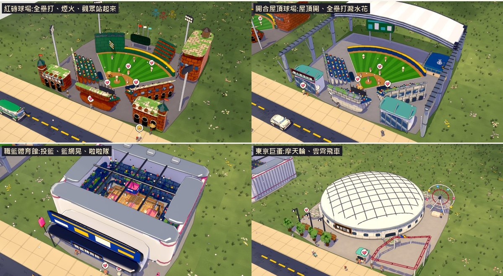
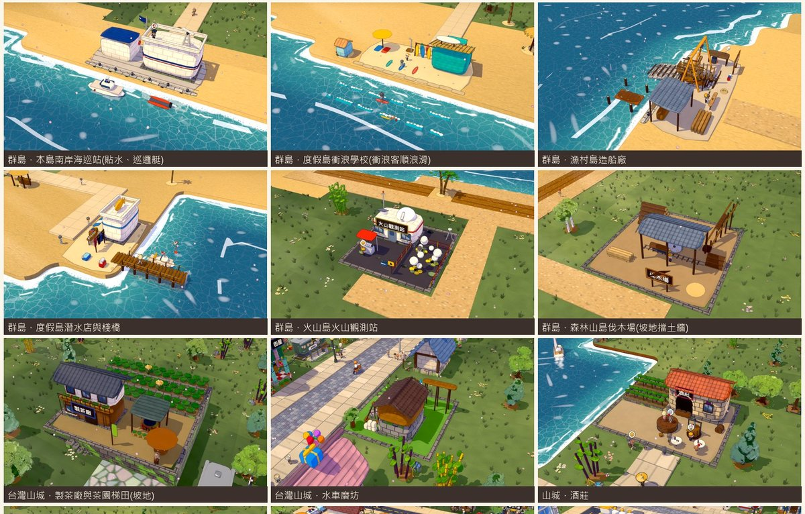
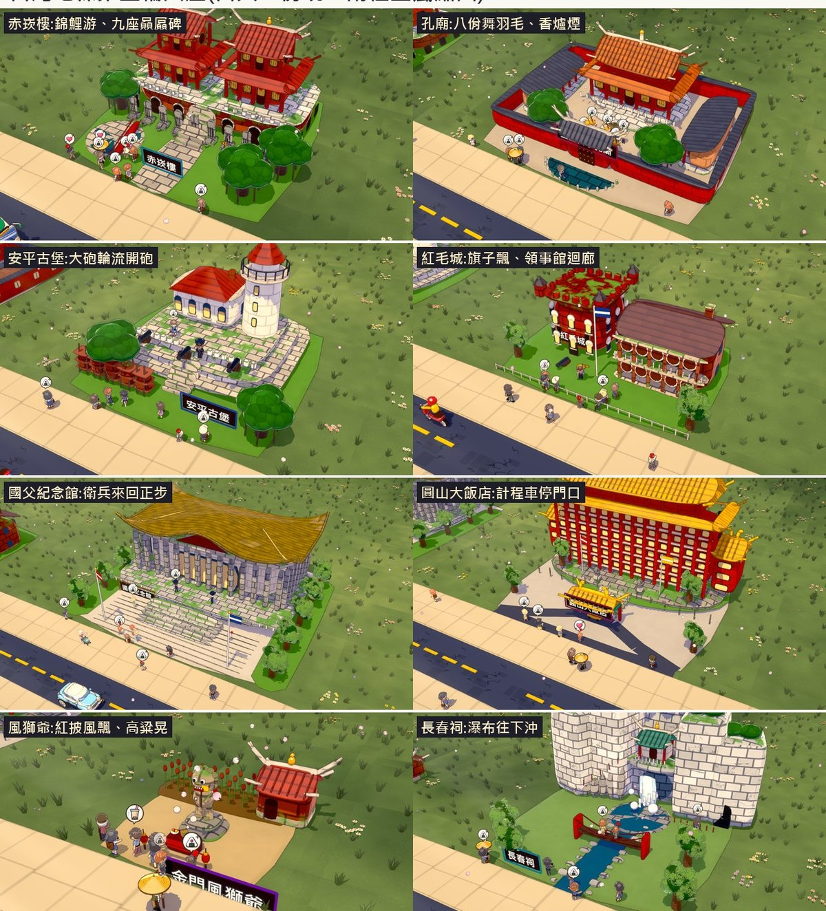

# 模擬樂園

蓋一座屬於你的城市和樂園:道路、鐵道、路面電車、港口、機場,再加上遊樂設施、動物園和世界地標。居民會上班、上學、逛夜市,遊客會排隊坐雲霄飛車。

- 將近 1000 種建築與物件,有兩種畫風可以切換(經典、新畫風)
- 自由模式、經營模式(建造花費、維護費、挑戰目標)
- 範例小鎮:現代都會、古城、夜市老街、工業港區、大學城、群島、山城、台灣山城
- 台灣與世界地標:台北 101、赤崁樓、國父紀念館、東京巨蛋、台北大巨蛋、凱旋門、金門大橋……
- 日夜、四季、天氣、節慶,夜晚有燈光與霓虹

## 下載(Windows)

到右邊的 **Releases**,打開「模擬樂園 第一版(Windows)」,下載 **SimPark-v1.0.1-Windows.zip**(約 710 MB)。

直接下載:<https://github.com/Benny-pig/sim-park/releases/download/v1.0.1/SimPark-v1.0.1-Windows.zip>

不用安裝 Godot,解壓縮就能玩。

## 怎麼玩

1. 先把整個壓縮檔**解壓縮**到一個資料夾(例如 `桌面\模擬樂園`),不要在壓縮檔裡直接點開。
2. 點兩下 **模擬樂園.exe**。旁邊的「模擬樂園.pck」是遊戲資料,要跟 exe 放在同一個資料夾。
3. 如果跳出藍色視窗「Windows 已保護您的電腦」:按「其他資訊」→「仍要執行」。這個遊戲還沒有付費的數位簽章,Windows 第一次看到會這樣提醒,是正常的。
4. 第一次開大約要等 1 分鐘,這段時間視窗可能暫時沒有反應,請不要關掉。之後再開大約 10 秒。

## 電腦需求

- Windows 10 或 Windows 11(64 位元)
- 支援 DirectX 12 或 Vulkan 的顯示卡(測試過 GeForce GTX 1070)
- 記憶體 8 GB 以上
- 硬碟:遊戲約 0.8 GB,存檔和建築模型快取另外最多 1~2 GB

## 存檔在哪

在檔案總管的網址列貼上 `%APPDATA%\Godot\app_userdata\模擬樂園`,按 Enter。

- `saves`:自動存檔(每 2 分鐘一次)和存檔欄
- `model_cache`:建築模型快取,可以刪,刪了不影響存檔

移除遊戲:刪掉遊戲資料夾就好;要連存檔一起刪,再刪掉上面那個資料夾。

## 製作名單與授權

- 製作:Benny、RonnieDan
- 音樂:Kevin MacLeod([incompetech.com](https://incompetech.com)),依 [CC BY 4.0](https://creativecommons.org/licenses/by/4.0/) 授權使用,曲目列在遊戲資料夾的「製作名單.txt」
- 人物、動物部分模型:KayKit(Kay Lousberg,CC0)
- 遊戲引擎:[Godot Engine](https://godotengine.org)(MIT 授權,全文與第三方元件授權見遊戲資料夾的「Godot授權.txt」)

## 版權聲明

© 2026 Benny,版權所有。

本遊戲僅供個人免費遊玩。未經作者書面同意,禁止修改、拆解、反組譯、重新包裝、販售或以任何形式再散布本遊戲或其中的程式、圖像與模型。

上面列出的第三方素材(Kevin MacLeod 的音樂、KayKit 模型、Godot Engine)依各自的授權條款使用,不在此限。

這個庫只放遊戲下載與說明,遊戲原始碼沒有公開。
